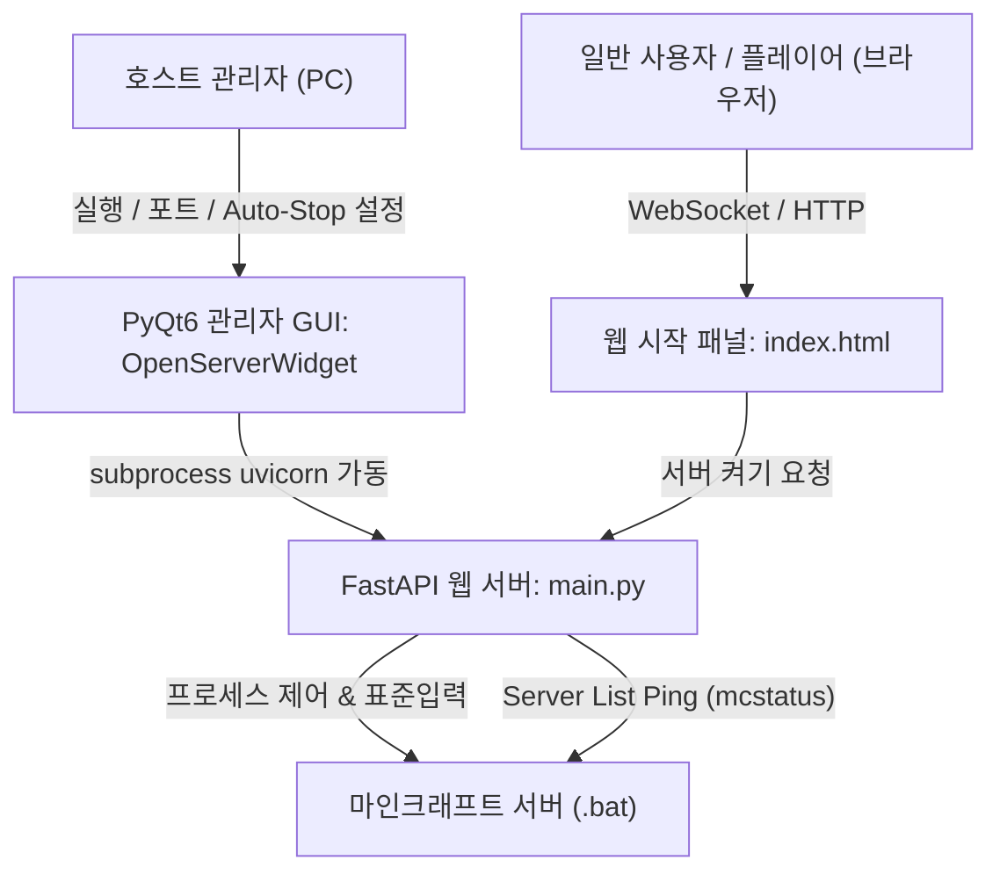

# Minecraft Server Web Controller (마인크래프트 서버 웹 컨트롤러)

호스트(관리자)는 **PyQt6 GUI**로 서버 리소스 및 자동 종료를 관리하고, 일반 플레이어(사용자)는 **웹 패널**을 통해 간편하게 마인크래프트 서버를 켤 수 있도록 분리된 하이브리드 제어 시스템입니다.

---

## 📌 프로젝트 아키텍처 및 역할 분담



### 1. 호스트 관리자 GUI (`PyQt6`)
- 마인크래프트 `.bat` 파일 경로 설정 및 Uvicorn 웹서버 실행/종료
- **실시간 서버 상태 및 접속자 수 모니터링**
- **빈 서버(0명) 자동 종료 설정**: 체크박스 On/Off 및 대기 시간(기본 10분, 1~180분) 설정 (설정은 `src/server_config.json`에 영구 저장)
- **마인크래프트 콘솔 명령어 직접 전송**: 관리자 창에서 REST API를 통해 마인크래프트 서버에 직접 명령어(op, list 등) 전송 가능

### 2. 일반 플레이어 웹 화면 (`index.html`)
- 깔끔하고 직관적인 모바일/PC 반응형 카드 UI
- **현재 서버 상태** (온라인 / 오프라인 / 켜지는 중) 및 **접속 인원** 표시
- 서버가 꺼져 있을 때 누를 수 있는 직관적인 **[마인크래프트 서버 켜기]** 원클릭 버튼 제공
- 관리자용 콘솔이나 복잡한 차트를 숨겨 보안 및 사용자 편의성 강화

---

## 📂 프로젝트 구조

```
web_server_for_minecraft_server/
├── main.py                     # 애플리케이션 진입점 (FastAPI 앱 정의 및 PyQt6 실행)
├── run.bat                     # 빠른 실행 배치 파일 (uv run python main.py)
├── pyproject.toml              # 프로젝트 의존성 및 pytest 설정
├── README.md                   # 프로젝트 아키텍처 및 가이드 문서
├── src/
│   ├── gui/
│   │   ├── api_server_worker.py  # Uvicorn 서브프로세스 실행 및 관리
│   │   └── open_server_widget.py # PyQt6 호스트 관리자 메인 창 (Auto-Stop 설정 포함)
│   ├── models/
│   │   └── models.py             # REST API Pydantic 모델
│   ├── router/
│   │   ├── server_manager.py     # 마인크래프트 서버 REST API
│   │   └── websocket.py          # 실시간 웹소켓 엔드포인트 (/ws/stream)
│   ├── templates/
│   │   └── index.html            # 일반 플레이어용 심플 시작 웹 패널
│   └── util/
│       ├── config.py             # Auto-Stop 설정 저장 및 로드
│       ├── database.py           # mcstatus 핑 및 0명 자동 종료 백그라운드 태스크
│       ├── message_type.py       # 웹소켓 메시지 Enum
│       ├── server_data.py        # 마인크래프트 프로세스 구동/정지/입출력 제어
│       └── server_status.py      # 실시간 서버 상태 캐시 모델
└── tests/
    ├── test_gui.py             # PyQt6 메인 위젯 단위 테스트
    ├── test_rest_api.py        # FastAPI REST API 엔드포인트 테스트
    ├── test_server_data.py     # ServerData 및 모델 테스트
    └── test_websocket.py       # 실시간 웹소켓 연결 테스트
```

---

## 🚦 기능 구현 현황

| 구분 | 기능 항목 | 상태 | 설명 |
| :--- | :--- | :---: | :--- |
| **호스트 GUI** | 웹서버 가동 및 포트 제어 | ✅ 완료 | Uvicorn 프로세스 제어 및 포트 설정 |
| | 빈 서버(0명) 자동 종료 설정 | ✅ 완료 | 자동 종료 활성화 여부 및 대기 분(min) 스핀박스 제공 (`server_config.json` 저장) |
| | 콘솔 명령어 직접 전송 | ✅ 완료 | GUI에서 REST API를 호출하여 마인크래프트 표준 입력으로 명령 전달 |
| | 실시간 상태 표시 | ✅ 완료 | 마인크래프트 구동 상태, 접속자 수 확인 가능 |
| **사용자 웹** | 서버 상태 및 접속자 확인 | ✅ 완료 | 오프라인 / 켜지는 중 / 온라인 실시간 뱃지 및 인원수 표시 |
| | 원클릭 서버 켜기 | ✅ 완료 | 꺼져 있을 때 버튼 클릭으로 즉시 서버 시작 요청 |
| **백엔드 엔진** | Server List Ping 연동 | ✅ 완료 | `mcstatus` 비동기 핑으로 패킷 수준에서 플레이어 수 실시간 측정 |
| | Auto-Stop 자동 감지 루프 | ✅ 완료 | 플레이어가 0명이면 설정된 시간 후 안전하게 `stop` 수행 |
| | 테스트 자동화 | ✅ 완료 | `pytest` 11개 테스트 항목 100% 통과 |

---

## 🚀 실행 및 테스트 방법

### 테스트 실행
```bash
uv run pytest
```

### 호스트 GUI 실행
```bash
uv run python main.py
# 또는
run.bat
```
1. 호스트 GUI 창에서 마인크래프트 서버 실행 파일(`.bat`) 경로를 지정합니다.
2. 원하는 빈 서버 자동 종료 시간(예: 10분)을 설정합니다.
3. **웹서버 시작** 버튼을 누릅니다.
4. 친구들에게 `http://<호스트IP>:9000/server/index.html` 주소를 공유하면 친구들이 브라우저에서 서버를 켤 수 있습니다.
