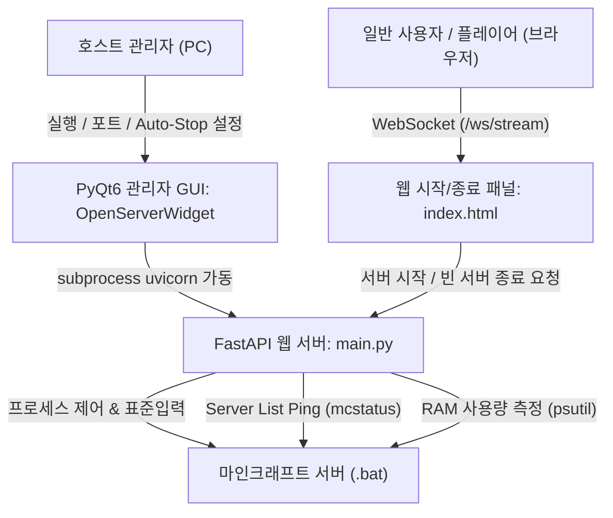

# Minecraft Server Web Controller (마인크래프트 서버 웹 컨트롤러)

호스트(관리자)는 **PyQt6 GUI**로 실시간 콘솔 로그, RAM 사용량, 플레이어 수 및 자동 종료를 관리하고, 일반 플레이어(사용자)는 **웹 패널**을 통해 간편하게 마인크래프트 서버를 켜고 안전하게 끌 수 있는 하이브리드 제어 시스템입니다.

---

## 📌 프로젝트 아키텍처 및 역할 분담



### 1. 호스트 관리자 GUI (`PyQt6`, `OpenServerWidget`)
- **실시간 콘솔 로그 뷰어**: 마인크래프트 서버의 표준 출력/에러 출력을 실시간으로 스트리밍하여 검은색 터미널 뷰어에 표시하고 자동 스크롤
- **실시간 RAM 사용량 모니터링**: `psutil`을 통해 마인크래프트 실행 스크립트 및 자식 Java 프로세스의 물리 메모리(RSS) 점유율을 계산하여 실시간 표시 (예: `4.25 GB`)
- **실시간 접속자 수 동기화**: `mcstatus` Server List Ping 결과를 `mc_players_lb` 라벨에 실시간 반영 (예: `접속자: 2 / 20 명`)
- **빈 서버(0명) 자동 종료 설정**: 체크박스 On/Off 및 대기 시간(분) 설정 (`server_config.json` 자동 저장)
- **콘솔 명령어 직접 전송**: 관리자 창에서 엔터키나 Send 버튼으로 서버에 직접 명령어(`op`, `list`, `save-all` 등) 전달

### 2. 일반 플레이어 웹 화면 (`index.html`)
- 깔끔하고 직관적인 모바일/PC 반응형 카드 UI
- **현재 서버 상태** (오프라인 / 켜지는 중 / 온라인 / 월드 저장 및 종료 중) 및 **접속 인원** 표시
- 서버가 꺼져 있을 때 누를 수 있는 직관적인 **[마인크래프트 서버 켜기]** 버튼 제공
- **안전 종료 버튼**: 접속자가 0명일 때만 `[서버 안전 종료]` 버튼이 활성화되어 사용자가 게임을 마쳤을 때 직접 종료 가능 (1명 이상 플레이 중일 땐 비활성화)

---

## 📂 프로젝트 구조

```
web_server_for_minecraft_server/
├── main.py                     # 애플리케이션 진입점 (FastAPI 앱 정의 및 PyQt6 실행)
├── run.bat                     # 빠른 실행 배치 파일 (uv run python main.py)
├── pyproject.toml              # 프로젝트 의존성 및 pytest 설정
├── README.md                   # 프로젝트 아키텍처 및 가이드 문서
├── src/
│   ├── gui/
│   │   ├── api_server_worker.py  # Uvicorn 서브프로세스 실행 및 관리
│   │   └── open_server_widget.py # PyQt6 호스트 관리자 GUI (로그, RAM, 접속자, 명령어)
│   ├── models/
│   │   └── models.py             # REST API Pydantic 모델
│   ├── router/
│   │   ├── server_manager.py     # 마인크래프트 서버 REST API (/status, /start-server 등)
│   │   └── websocket.py          # 실시간 웹소켓 엔드포인트 (/ws/stream)
│   ├── templates/
│   │   └── index.html            # 일반 플레이어용 심플 시작/종료 웹 패널
│   └── util/
│       ├── config.py             # Auto-Stop 설정 저장 및 로드
│       ├── database.py           # mcstatus 핑, psutil RAM 측정, Auto-Stop 백그라운드 태스크
│       ├── log_filter.py         # Uvicorn 콘솔 도배 방지 엔드포인트 필터
│       ├── message_type.py       # 웹소켓 메시지 Enum
│       ├── server_data.py        # 마인크래프트 프로세스 제어 (90초 Graceful Shutdown 적용)
│       └── server_status.py      # 실시간 서버 상태 캐시 모델
└── tests/
    ├── test_gui.py             # PyQt6 메인 위젯 단위 테스트
    ├── test_rest_api.py        # FastAPI REST API 엔드포인트 테스트
    ├── test_server_data.py     # ServerData 및 모델 테스트
    └── test_websocket.py       # 실시간 웹소켓 연결 테스트
```

---

## 🚦 기능 구현 현황

| 구분 | 기능 항목 | 상태 | 설명 |
| :--- | :--- | :---: | :--- |
| **호스트 GUI** | 실시간 콘솔 로그 뷰어 | ✅ 완료 | GUI 창 내에 터미널 로그창을 탑재하여 서버 로그 실시간 출력 |
| | 프로세스 RAM 사용량 모니터링 | ✅ 완료 | `psutil`로 Java 프로세스 총 물리 메모리 사용량(GB) 실시간 표시 |
| | 실시간 접속자 수 동기화 | ✅ 완료 | `mcstatus` 핑 결과를 `mc_players_lb` 라벨에 실시간 갱신 (`2 / 20 명`) |
| | 빈 서버(0명) 자동 종료 제어 | ✅ 완료 | 자동 종료 활성화 여부 및 대기 분(min) 스핀박스 제공 (`server_config.json` 저장) |
| | 콘솔 명령어 직접 전송 | ✅ 완료 | GUI에서 REST API를 호출하여 마인크래프트 표준 입력으로 명령 전달 |
| **사용자 웹** | 서버 상태 및 접속자 확인 | ✅ 완료 | 오프라인 / 켜지는 중 / 온라인 / 저장 중 실시간 뱃지 및 인원수 표시 |
| | 원클릭 서버 켜기 | ✅ 완료 | 꺼져 있을 때 버튼 클릭으로 즉시 서버 시작 요청 |
| | 빈 서버 안전 종료 버튼 | ✅ 완료 | 접속자가 0명일 때만 사용자가 직접 종료할 수 있는 버튼 제공 |
| **안정성/백엔드** | Graceful Shutdown (월드 저장) | ✅ 완료 | `stop\n` 전송 후 최대 90초간 자연 종료 대기 (강제 킬 방지) |
| | 테스트 자동화 | ✅ 완료 | `pytest` 11개 테스트 항목 100% 통과 |

---

## 🚀 실행 및 테스트 방법

### 테스트 실행
```bash
uv run pytest
```

### 호스트 GUI 실행
```bash
uv run python main.py
# 또는
run.bat
```
1. 호스트 GUI 창에서 마인크래프트 서버 실행 파일(`.bat`) 경로를 지정합니다.
2. 원하는 빈 서버 자동 종료 시간(예: 10분)을 설정합니다.
3. **웹서버 시작** 버튼을 누릅니다.
4. 관리자 창에서 실시간 콘솔 로그, RAM 사용량, 접속자 수를 모니터링하고 명령어를 보낼 수 있습니다.
5. 친구들에게 `http://<호스트IP>:9000/server/index.html` 주소를 공유하면 친구들이 브라우저에서 서버를 켜거나 빈 서버를 끌 수 있습니다.
