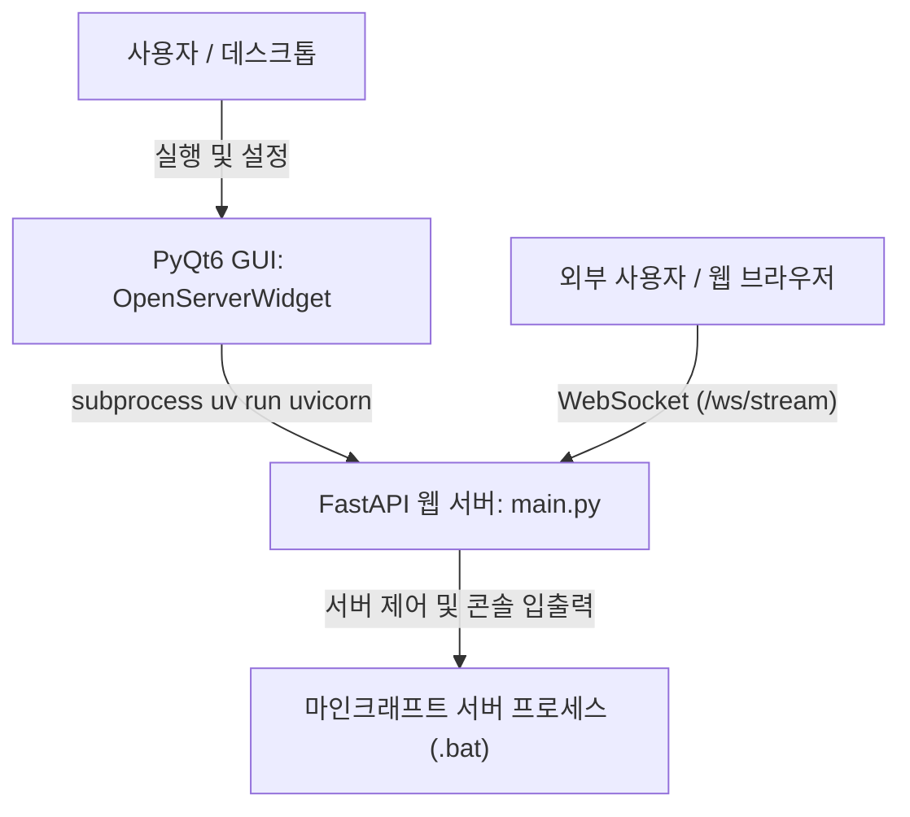

# Minecraft Server Web Controller (마인크래프트 서버 웹 컨트롤러)

FastAPI와 PyQt6를 결합하여 마인크래프트 서버의 실행/종료 및 콘솔 모니터링을 데스크톱 GUI 및 웹 패널을 통해 제어할 수 있도록 설계된 프로젝트입니다.

---

## 📌 프로젝트 아키텍처 및 동작 원리

이 프로젝트는 **PyQt6 GUI 애플리케이션**이 백그라운드로 **FastAPI 웹 서버(Uvicorn)** 프로세스를 띄우고, 사용자는 데스크톱 GUI 또는 웹 브라우저를 통해 마인크래프트 서버(.bat 파일)를 실행하고 관리하는 **이중 제어(Hybrid Controller)** 구조를 갖추고 있습니다.



1. **PyQt6 GUI 실행 (`main.py` -> `OpenServerWidget`)**:
   - 서버 구동 스크립트(`.bat`) 경로 선택 및 파일 저장 (`src/server_file_path.txt`).
   - 웹 서버 포트 설정(기본 9000).
   - `Start` 클릭 시 `ApiServerWorker`를 통해 `uv run uvicorn main:app` 프로세스 실행.
2. **FastAPI 웹 서버 & 실시간 웹소켓 (`main.py` / `src/router/`)**:
   - 웹 패널 호스팅: `http://localhost:<포트>/server/` (신규 대시보드가 적용된 `index.html`).
   - 양방향 웹소켓 통신 (`/ws/stream`):
     - 서버 상태 (오프라인 / 켜지는 중 / 온라인 / 접속자 수) 실시간 전송
     - 실시간 마인크래프트 콘솔 로그 스트리밍 (새로운 로그 발생 시 브로드캐스트)
     - 웹 브라우저에서 서버 시작/종료 명령 및 콘솔 명령어(`help`, `op` 등) 전송 처리

---

## 📂 프로젝트 구조

```
web_server_for_minecraft_server/
├── main.py                     # 애플리케이션 진입점 (FastAPI 앱 정의 및 PyQt6 실행)
├── run.bat                     # 빠른 실행 배치 파일 (uv run main.py)
├── pyproject.toml              # 프로젝트 의존성 설정 (uv / setuptools)
├── README.md                   # 프로젝트 설명 및 상태 문서
└── src/
    ├── gui/
    │   ├── __init__.py
    │   ├── api_server_worker.py  # Uvicorn 서브프로세스 실행 및 Taskkill 관리 QObject
    │   └── open_server_widget.py # PyQt6 메인 GUI 윈도우
    ├── models/
    │   ├── __init__.py
    │   └── models.py             # FastAPI 요청용 Pydantic 모델 (Command, ReadLine)
    ├── router/
    │   ├── __init__.py
    │   ├── server_manager.py     # 마인크래프트 서버 제어 REST API 라우터
    │   └── websocket.py          # 실시간 웹소켓 라우터 (/ws/stream)
    ├── templates/
    │   ├── index.html            # 실시간 웹소켓 + Tailwind + Chart.js 통합 대시보드
    │   └── new_index.html        # 대시보드 백업 템플릿
    └── util/
        ├── __init__.py
        ├── database.py           # 서버 상태 캐시 및 백그라운드 모니터링 태스크
        ├── message_type.py       # 웹소켓 메시지 Enum (ERROR, STATUS, LOG)
        ├── server_data.py        # 마인크래프트 프로세스 실행/중지, 입출력 핵심 클래스
        ├── server_log.py         # 로그 관리 유틸리티 클래스
        └── server_status.py      # 서버 상태 데이터 클래스
```

---

## 🚦 현재 구현 상태 및 진척도

| 기능 영역 | 세부 항목 | 상태 | 설명 |
| :--- | :--- | :---: | :--- |
| **GUI (PyQt6)** | 서버 경로(.bat) 탐색 및 저장 | ✅ 완료 | `QFileDialog` 선택 및 `src/server_file_path.txt` 저장/불러오기 지원 |
| | API 웹서버 On/Off 제어 | ✅ 완료 | `ApiServerWorker`를 통해 `uvicorn` 프로세스 시작/종료 지원 |
| **웹 프론트엔드** | 실시간 모던 대시보드 (`index.html`) | ✅ 완료 | Tailwind CSS, Chart.js, 웹소켓 자동 재연결, 로그 자동 스크롤 적용 |
| | 전원 제어 (시작/안전 종료) | ✅ 완료 | 웹소켓 액션을 통해 마인크래프트 서버 시작 및 안전 종료 지원 |
| | 실시간 콘솔 명령어 전송 | ✅ 완료 | 엔터키 또는 전송 버튼으로 마인크래프트 표준 입력(stdin)에 직접 전송 |
| **백엔드 & 실시간성** | 웹소켓 라우터 (`/ws/stream`) | ✅ 완료 | 양방향 통신 (로그 실시간 tailing, 상태 브로드캐스트, 액션 처리) |
| | 백그라운드 모니터링 | ✅ 완료 | `monitor_minecraft_server` 비동기 루프로 서버 시작/구동 완료 상태 추적 |
| | 로그/프로세스 입출력 | ✅ 완료 | `ServerData`의 버그 수정, UTF-8 인코딩 및 stdin flush 처리 |

---

## 🚀 실행 방법

### 요구 사항
- Python >= 3.11
- [uv](https://github.com/astral-sh/uv) 패키지 매니저

### 실행
```bash
# GUI 실행 (기본)
uv run python main.py
# 또는
run.bat
```
1. GUI 창에서 **서버 파일 위치**의 `find` 버튼을 눌러 마인크래프트 서버의 `.bat` 파일을 선택합니다.
2. 포트 번호(기본 9000)를 확인한 후 **Start** 버튼을 누르면 웹 서버가 구동됩니다.
3. 브라우저에서 `http://localhost:9000/server/index.html`로 접속하여 실시간 대시보드로 서버를 제어합니다.
